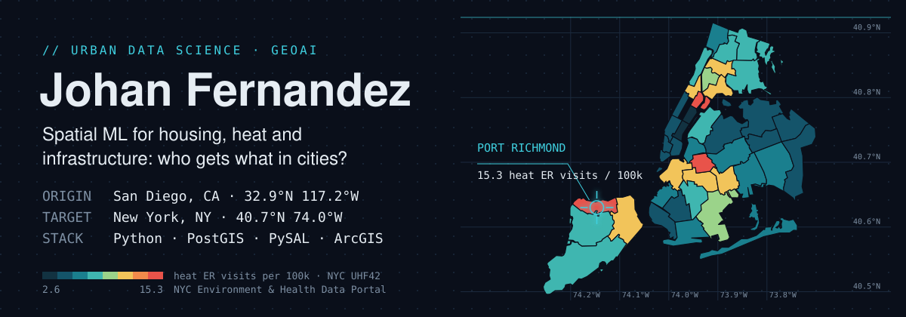
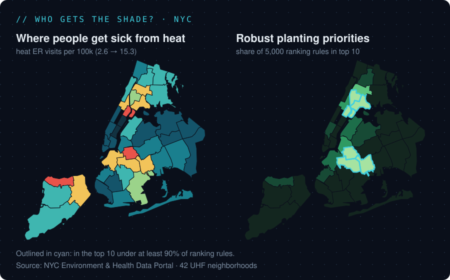
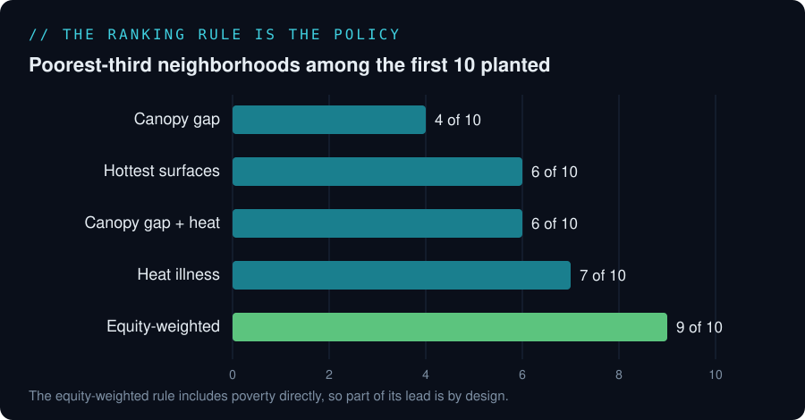
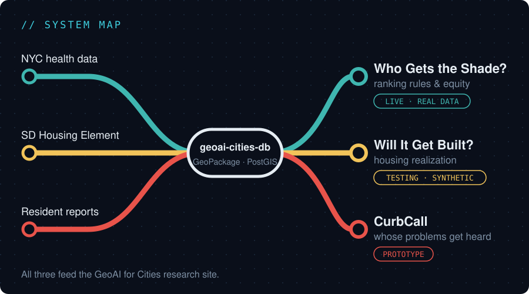

### Urban data scientist · GeoAI for housing, land use and infrastructure

I build **location-aware machine learning and spatial analysis** around one question: **who gets what in cities?** My work combines GIS, spatial statistics and predictive modeling with California and New York planning policy.

🎓 B.A. Urban Studies & Planning, UC San Diego · preparing for doctoral study in urban data science
📍 San Diego, CA · 📫 jhoven.jan98@gmail.com
🌐 **[GeoAI for Cities research site](https://jhovenf98.github.io/geoai-for-cities/)** · [Portfolio](https://jhovenf98.github.io/Johan.github.io/)

---

### 🧭 Research focus

- **GeoAI for housing policy:** predicting where zoned capacity actually becomes housing, and auditing those predictions for equity
- **Spatially honest machine learning:** spatial cross-validation, calibration and explainability, so models hold up in places they have never seen
- **Ranking and fairness:** how the rule a city uses to rank neighborhoods decides who benefits first
- **Responsible AI in city government:** transparency and resident voice in AI-assisted decisions (3rd place, UCSD Urban Expo)

---

### ✍️ Blog: GeoAI for Cities series

- **[Part 1 · What Is GeoAI? Definitions, Foundations and Five Verbs Across U.S. Cities](https://jhovenf98.github.io/geoai-for-cities/#part-1)**
- **[Part 2 · Who Gets the Shade? Ranking New York Neighborhoods for Tree Planting](https://jhovenf98.github.io/geoai-for-cities/#part-2)** (working paper)
- [Research Notes: Questions, Methods and Data](https://jhovenf98.github.io/geoai-for-cities/#research) · [All posts](https://jhovenf98.github.io/geoai-for-cities/#blog)

---

### 🗺️ GeoAI for Cities: research projects

#### 🌳 [Who Gets the Shade?](https://github.com/jhovenf98/who-gets-the-shade) · `LIVE · REAL DATA`
When NYC ranks neighborhoods for tree planting, how much does the ranking rule change who benefits?

Across NYC's 42 UHF neighborhoods, each point of tree canopy is associated with 0.17 °F lower surface temperature, but heat-related ER visits track poverty (r = 0.59) far more than heat. Switching the ranking rule moves the poorest neighborhoods from 4 to 9 of the first 10 planted. (The equity-weighted rule includes poverty directly, so part of that jump is by design; the open question is what each rule trades away.)

**Methods:** Moran's I/LISA · spatial lag & error models · leave-one-borough-out CV · 5,000 random weightings · [interactive map](https://jhovenf98.github.io/geoai-for-cities/explore/shade.html)

#### 🏗️ [Will It Get Built?](https://github.com/jhovenf98/housing-site-realization) · `TESTING · SYNTHETIC DATA`
Which of San Diego's 2021 Housing Element sites actually got housing approvals, and can a model predict it better than the city's capacity assumptions? *Pipeline built and validated on synthetic data; real-data run in progress.*

**Methods:** spatial CV · LightGBM · calibration · SHAP · equity audit · [explorer](https://jhovenf98.github.io/geoai-for-cities/explore/housing.html)

#### 📣 [CurbCall](https://github.com/jhovenf98/curbcall) · `PROTOTYPE`
If residents report and vote on what to fix first, whose problems get heard?

**Methods:** product prototype · PostGIS data model · per-area ranking · [app demo](https://jhovenf98.github.io/geoai-for-cities/explore/curbcall.html)

**Behind all three:** [geoai-cities-db](https://github.com/jhovenf98/geoai-cities-db), one GeoPackage + PostGIS database with synthetic-data flags ([explorer](https://jhovenf98.github.io/geoai-for-cities/explore/database.html)), and [GeoAI for Cities](https://github.com/jhovenf98/geoai-for-cities), the research site and article series.

#### How the projects fit together

---

### 🚧 Next up

Planned projects, built one at a time. Full list with data sources and methods in **[ROADMAP.md](ROADMAP.md)**.

- **Will It Get Built? (real-data run):** run the tested pipeline on San Diego's actual permit records
- **Who Waits Longer?:** survival analysis of NYC 311 response times by neighborhood
- **Minutes to Opportunity:** transit access to jobs from MTA GTFS with r5py
- **Streets That See:** computer vision on street-level imagery, validated against NYC's tree census

---

### 🛠️ Applied GIS work

| Project | What I did |
|---|---|
| Municipal stormwater priority mapping | Geodatabases ranking Capital Improvement Plan sites across four San Diego cities under MS4/NPDES permits |
| UCSD campus CAD-to-GIS & UAV mapping | Georeferenced 1,788 AutoCAD drawings into an ArcGIS Pro basemap; drone orthomosaics with Drone2Map |
| Community health equity mapping | Census/ACS data joined with infrastructure layers to find service gaps in underserved neighborhoods |

---

### 🧰 Toolkit

**GeoAI & ML:** Python · GeoPandas · PySAL (esda, spreg) · scikit-learn · LightGBM · SHAP
**Spatial data:** PostgreSQL/PostGIS · GeoPackage · GDAL/OGR · SQL · ArcGIS Pro · ArcPy · QGIS · Drone2Map
**Web & viz:** Folium/Leaflet · D3 · Power BI · Tableau
**Planning:** Housing Element & RHNA · land use & zoning · CEQA · MS4/NPDES · equity mapping
